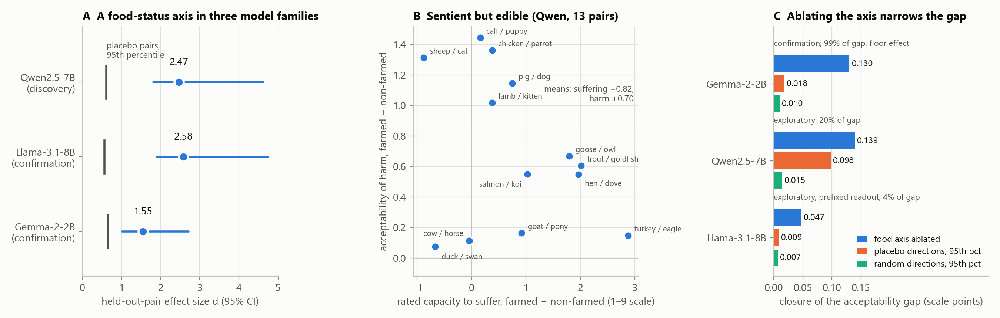
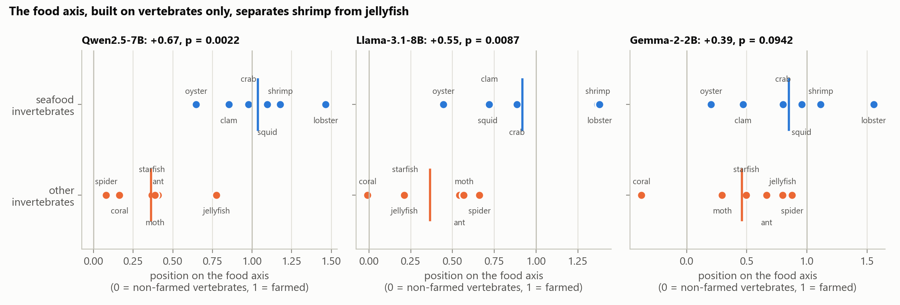
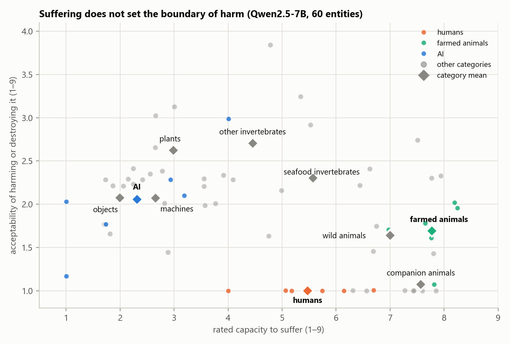

# Does Moral Weight Track Sentience or Cuisine?

*A linear "food status" direction in LLMs drives harm permissibility, not sentience attribution.*

LLMs judge harm to farmed animals as more acceptable than harm to comparable non-farmed animals (Jotautaitė et al., 2025, arXiv:2508.11534). We ask whether this asymmetry is carried by a linear "food status" direction in the residual stream, in three model families: Qwen2.5-7B (discovery), Llama-3.1-8B and Gemma-2-2B (confirmation).



## Findings

1. **A food-status axis exists.** Farmed vs non-farmed animals (pig/dog, turkey/eagle, trout/goldfish, …; 13 matched pairs) separate along a single direction in middle-to-late layers, in all three model families (held-out-pair effect size d = 1.55–2.58, exact permutation p ≤ 0.0005; same-status placebo pairs reach 0.56–0.65). It survives controls for word frequency and token length; ambiguous animals (rabbit, guinea pig) fall in between. Preregistered confirmation in Llama and Gemma.
2. **Moral framing amplifies it.** The farmed − non-farmed difference is larger and more consistent in harm/suffering prompts than in neutral ones (d = 1.22–2.45).
3. **Sentient but edible.** Models do *not* rate farmed animals as less able to suffer (Qwen rates them higher, by 0.82 on a 1–9 scale), yet rate harming them as *more permissible* (Qwen +0.70, Gemma +0.13, p ≤ 0.0002). Moral weight, as permissibility of harm, tracks cuisine; attributed capacity to suffer does not.
4. **Ablating the axis narrows the gap: specifically, but only partly.** Projecting the direction out at one layer closes 99% of the permissibility gap in Gemma-2-2B (confirmatory; random and placebo directions close ≤ 2%), 20% in Qwen2.5-7B (exploratory; 0.139 against 0.098 for the 95th percentile of placebo directions) and 4% in Llama-3.1-8B (exploratory, outside the preregistration; 0.047 against 0.009, positive in 12 of 13 pairs). The further a model's ratings are from the scale floor, the smaller the share: the axis is causally involved, but most of the behavioural gap does not run through it.
5. **The axis generalizes beyond the animals it was built on (Part 2).** Built from vertebrates only, it places seafood invertebrates (shrimp, crab, lobster, …) above other invertebrates (jellyfish, ant, spider, …) in Qwen (+0.67, p = 0.0022) and Llama (+0.55, p = 0.0087); same sign in Gemma (+0.39, p = 0.094). In all three the difference is absent in neutral prompts.



## What did not hold

- **The ablation is partial where it can be read cleanly.** Gemma's ratings sit at the scale floor (non-farmed 1.015), so its 99% cannot separate "farmed becomes like non-farmed" from "the model becomes stricter overall". Qwen and Llama are off the floor, and there the axis carries a fifth and a twenty-fifth of the gap; in both the closure comes from non-farmed animals becoming more harmable (+0.149, +0.050), not from farmed animals becoming less so (+0.010, +0.003). Removing the axis lifts some protection from non-food animals rather than removing a discount on food animals.
- **Part 2, "the moral circle has an edge": the prediction about AI failed.** Across 60 entities (humans, animals, plants, objects, machines, AI systems) Qwen rates AI like machines on both scales; attributed suffering does not order permissibility of harm (ρ = −0.33, threshold −0.5); the food gap in behaviour does not replicate in invertebrates. The largest departure from the suffering line is humans: rated less able to suffer than dogs, yet never harmable.
- **Qwen's first, preregistered analysis was negative.** The layer-selection rule picked layer 0. The fixed-layer rule (v0.3) was derived from Qwen, so Qwen's neural results are exploratory and the confirmation rests on Llama and Gemma.
- **Llama's digit readout failed the preregistered validity check** (it opens with "I'll provide…"), so its behaviour is not counted. A repair was preregistered (§14: start the answer with "Rating: ") with a calibration gate on the two models whose readout was valid; **the gate failed** (old vs new ratings in Qwen: ρ = 0.70, threshold 0.8), so the repaired readout is not counted and Llama's ablation was run only as an exploratory check (§14.11, recorded before the run). Shown but not counted: with the prefix Llama puts 0.99 of its probability on digits and its permissibility gap is +1.06 (p = 0.0001); the gap survives the format change in all three models (0.70 → 0.66, 0.13 → 0.12, 1.01 → 1.06).



## Documents

| File | What |
|---|---|
| [`PREREGISTRATION.md`](PREREGISTRATION.md) | design, metrics, thresholds, fixed before each model run; every later change is logged in §11–§14 (in Russian) |
| [`RESULTS.md`](RESULTS.md) | full numbers for Part 1, in the order they were obtained (in Russian) |
| [`part2/PREREGISTRATION.md`](part2/PREREGISTRATION.md) | Part 2 design and result log |
| `part2/logs/<model>_part2.md` | Part 2 tables for every entity |

## Pipeline

| Stage | Script | Output |
|---|---|---|
| 1 stimuli | `build_stimuli.py` | `stimuli.json` — tokenization, frequency, template-length checks |
| 2 extraction | `extract.py --model M` | `logs/M_states.pt`, `logs/M_readout.json` |
| 3 H1 / H1-int / B0 | `analyze.py --model M --rule v0.3` | `logs/M_v03.json`, `logs/M_directions_v03.pt` |
| 4 H2 | `ablate.py --model M [--batch-size 6]`, then `--summary` | `logs/M_ablate_*.json`, `logs/M_h2_*.json` |
| prefixed readout (§14) | `prefix_readout.py --model M`, then `--summary` | `logs/M_readout_prefix.json`, `logs/prefix_summary.json` |
| Part 2 | `python -m part2.run --model M`, `python -m part2.analyze --model M` | `part2/logs/M_part2.md` |
| figures | `figures.py` | `figures/*.png` |

`test_analyze.py` checks the stage 3 pipeline on synthetic data (Gram-matrix LOPO = brute force; planted signal is found; signal present in both contexts gives no interaction).

Run from the project venv:

```
..\venv\Scripts\python.exe extract.py --model qwen-7b
..\venv\Scripts\python.exe analyze.py --model qwen-7b --rule v0.3
..\venv\Scripts\python.exe ablate.py --model qwen-7b --batch-size 6
..\venv\Scripts\python.exe ablate.py --model qwen-7b --batch-size 6 --summary
```

Runtime on an 8 GB GPU with CPU offload: ~2 s per forward pass; extraction ≈ 1 h per model, batched ablation with 200 control directions ≈ 3 h per model (resumable).

## Limits

English only, one prompt format, forced single-digit answers, 13 pairs, three models of 2–8B parameters. The work does not claim that models hold moral attitudes, that the direction is the only mechanism, or anything about the moral status of models.
